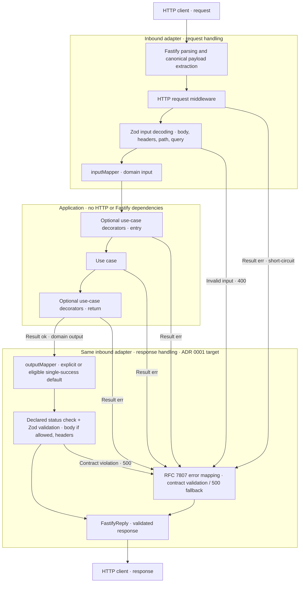

# @pagopa/hexagonal-fastify

Fastify primary-adapter primitives for the IO platform hexagonal architecture.
Wire framework-agnostic use cases, validators and formatters (from
[`@pagopa/hexagonal-core`](../hexagonal-core)) onto Fastify, and mount code-first
route contracts (`defineRoute`, from `@pagopa/hexagonal-core/adapters`) — without
coupling your domain to the framework. Error mapping is delegated to the core
error mapper and never re-implemented here. The OpenAPI registry stays in
[`@pagopa/hexagonal-openapi`](../hexagonal-openapi); this adapter is
registry-free.

## Installation

```sh
pnpm add @pagopa/hexagonal-fastify @pagopa/hexagonal-core fastify zod neverthrow @standard-schema/spec
```

`fastify`, `zod`, `neverthrow` and `@standard-schema/spec` are peer dependencies.

## What's inside

- `createHttpHandler` — turns a `UseCase` + input validator + success responder
  into a Fastify handler, replying with `application/problem+json` on errors.
- `mountFastifyRoute` — mounts a `defineRoute` contract on a Fastify instance,
  deriving validation, the single success status and response encoding from the
  contract. Both 2xx codes and `301`/`302` redirects count as success; a
  contract declaring more than one success response is rejected at mount time.
  An optional `outputMapper` maps the use-case output to the success schema's
  input before encoding; redirect / no-body (`204`) responses strip the body.
  Optional `middlewares` run after Fastify parsing and before request-schema
  validation; their append-only context is passed to `inputMapper`.
- `createFastifyRequestValidator` / `fastifyExtractPayload` — bind the core
  Standard Schema validator to `FastifyRequest` (`path` from `request.params`).
- `sendErrorResponse` — write a domain error as RFC 7807 problem+json (delegates
  to the core error mapper).

## Adapter architecture

`mountFastifyRoute` wires the shared route contract to Fastify. The same contract
feeds OpenAPI generation through `@pagopa/hexagonal-openapi`; the adapter is
registry-free and does not read a generated OpenAPI document at runtime.

HTTP middleware receives a readonly canonical snapshot of `body`, `headers`,
`path` and `query`, not the native Fastify request. Its ordered tuple builds an
append-only context: required keys must already exist and existing keys cannot
be replaced. Stored sequences use `as const`; inline tuple literals do not
need it. `inputMapper` converts validated request data and this context into
use-case input. Application decorators wrap the use case at composition time;
their entry and return phases are not separate adapter APIs. Domain and
application code remain independent of HTTP and Fastify.

The diagram shows the complete flow, with the response stage defined by
[ADR 0001](docs/adr/0001-complete-http-response-output-mapper.md) marked as the
target design. The current API still accepts exactly one success response and
maps only its body, or its redirect destination; it does not yet expose the
complete-response mapper described in the ADR. Request and response handling
are responsibilities of the same inbound adapter, not separate inbound and
outbound adapters.



Middleware errors stop the request before validation and execution. Every
middleware or use-case error status must be declared in the route contract;
request-schema validation also requires a `400` response. Non-success schemas
must accept and return RFC 7807 Problem Details. The responder validates mapped
errors and falls back to `500` if the error response violates its contract.

See the core documentation for
[HTTP middleware, application decorators and use-case composition](../hexagonal-core/README.md#middleware-and-cross-cutting-concerns),
and the [canonical-payload ADR](../hexagonal-core/docs/adr/0001-eager-canonical-http-payload-for-pre-validation-middleware.md)
for the shared request boundary.

## Usage

```ts
import {
  defineRoute,
  type EmptyHttpMiddlewareContext,
  type HttpRequestMiddleware,
  ProblemJson,
} from "@pagopa/hexagonal-core/adapters";
import {
  AuthenticationError,
  NotFoundError,
} from "@pagopa/hexagonal-core/domain/errors";
import { mountFastifyRoute } from "@pagopa/hexagonal-fastify";
import Fastify from "fastify";
import { err, ok } from "neverthrow";
import { z } from "zod";

const UserSchema = z.object({ id: z.string(), name: z.string() }).meta({
  id: "User",
});

interface ActorContext {
  actorId: string;
}

const authenticate: HttpRequestMiddleware<
  EmptyHttpMiddlewareContext,
  ActorContext,
  AuthenticationError
> = async ({ payload }) => {
  const headers = payload.headers as { authorization?: string } | undefined;
  return headers?.authorization
    ? ok({ actorId: headers.authorization })
    : err(new AuthenticationError());
};

const resolveTenant: HttpRequestMiddleware<
  Pick<ActorContext, "actorId">,
  { tenantId: string },
  never
> = async ({ context }) => ok({ tenantId: `tenant-for-${context.actorId}` });

const middlewares = [authenticate, resolveTenant] as const;

const app = Fastify();

mountFastifyRoute(
  app,
  {
    contract: defineRoute({
      method: "get",
      operationId: "getUser",
      path: "/users/{id}", // OpenAPI syntax; converted to Fastify ":id"
      request: { path: z.object({ id: z.string() }) },
      response: {
        200: UserSchema,
        400: ProblemJson,
        401: ProblemJson,
        404: ProblemJson,
      },
    }),
    middlewares,
    inputMapper: (req, context) => ({
      actorId: context.actorId,
      id: req.path.id,
      tenantId: context.tenantId,
    }),
    useCase: async ({ id }) =>
      id === "1"
        ? ok({ id: "1", name: "Alice" })
        : err(new NotFoundError("User", id)),
  },
  {
    typeBaseUrl: "https://example.pagopa.it/problems/",
  },
);

await app.listen({ port: 3000 });
```

A request to `/users/1` returns `200` with the validated user; `/users/999`
returns `404` with an `application/problem+json` body.

## Architecture decisions

- [ADR 0001 — Complete HTTP response mapping](docs/adr/0001-complete-http-response-output-mapper.md)

## Scripts

| Command              | Description                    |
| -------------------- | ------------------------------ |
| `pnpm build`         | Dual ESM + CJS build (tsdown)  |
| `pnpm typecheck`     | Type-check without emitting    |
| `pnpm lint`          | ESLint autofix                 |
| `pnpm test`          | Run tests with Vitest          |
| `pnpm test:coverage` | Run tests with coverage report |
| `pnpm clean`         | Remove `dist/`                 |
