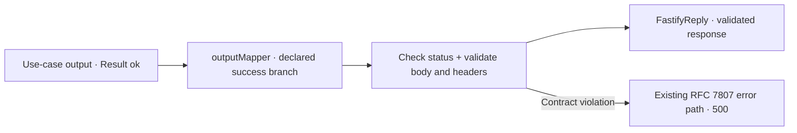

# ADR 0001: Complete HTTP response mapping in the Fastify adapter

- Status: Accepted
- Scope: `@pagopa/hexagonal-fastify` and the shared HTTP route contract

## Context

The current `outputMapper` maps use-case output only to a success body, or to a
redirect destination. Mounting requires exactly one success response, and only
redirects can declare response headers, as raw OpenAPI schemas.

Endpoints need to select among declared success responses and supply typed
headers without moving HTTP concerns into use cases. This accepted decision
defines that extension; it does not describe the currently available API.
See the [adapter architecture](../../README.md#adapter-architecture) for the
complete pipeline and layer responsibilities.

## Decision

Make `outputMapper` return a complete success-response description: `status`,
plus `body` and `headers` where required by the selected contract entry. Only
the adapter writes it to `FastifyReply`; use cases keep returning domain
`Result` values.

Infer a `status`-discriminated union from the contract's success entries. Each
branch ties its status to the corresponding body and header schemas. For
example, a contract may infer this illustrative type:

```ts
type EndpointResponse =
  | { status: 200; body: { id: string }; headers?: never }
  | {
      status: 202;
      body: { taskId: string };
      headers: { "x-job-id": string };
    };
```

Reject undeclared statuses or custom headers, mismatched bodies or header
values, and missing required headers at compile time. Header declarations
must support TypeScript inference, Zod validation and consistent OpenAPI
generation; raw OpenAPI schemas alone are insufficient.

### Validation and response writing

Before writing, check that the status is declared and validate the selected
branch's body and headers with Zod. Mapper values use `z.input`; validated,
transformed `z.output` values are serialized. Runtime checks remain necessary
for refinements and values that bypass TypeScript.

For `204` and redirects, require an absent body rather than applying a body
schema. Redirects also require a valid `Location` header. An output-contract
violation must not send the invalid success response: use the existing server
error path (`500`). Input validation remains `400`; middleware and use-case
errors retain the existing RFC 7807 mapping.



### Defaults and multiple successes

A default mapper is available only for exactly one declared success, when no
explicit mapper is supplied:

| Success entry | Default mapping                                                                                                                                                                                                     |
| ------------- | ------------------------------------------------------------------------------------------------------------------------------------------------------------------------------------------------------------------- |
| Body response | Use domain output as the body; require compatibility with the schema input and validate it at runtime.                                                                                                              |
| `204`         | Ignore domain output and omit the body.                                                                                                                                                                             |
| Redirect      | Use the string output as `location` (`Location` is case-insensitive), omit the body and use the declared redirect status. Require a compatible output type; an empty or invalid destination follows the `500` path. |

Defaults add no custom headers beyond redirect `Location`, no empty header
objects and no dummy bodies. They undergo the same output checks. If required
headers cannot be produced by the default, the mount configuration must
require an explicit mapper at compile time.

With two or more successes, require an explicit mapper at compile time, even
when branch bodies are identical. It selects a declared branch; never infer
one from declaration order, numeric status order or body contents. Contracts
with no success response remain invalid at mount time, without a fallback.

## Consequences

- One contract drives response types, runtime validation and OpenAPI output;
  HTTP response choices remain in the adapter.
- Existing explicit body-only mappers require an incompatible migration to
  complete-response descriptions.
- The shared core contract, Fastify adapter and OpenAPI generator must evolve
  together, including runtime checks and typed header declarations.

## References

- [Fastify mount and responder](../../src/mountRoute.ts)
- [Shared HTTP route contract](../../../hexagonal-core/src/adapters/route-contract/routeContract.ts)
- [OpenAPI generator](../../../hexagonal-openapi/src/generate.ts)
