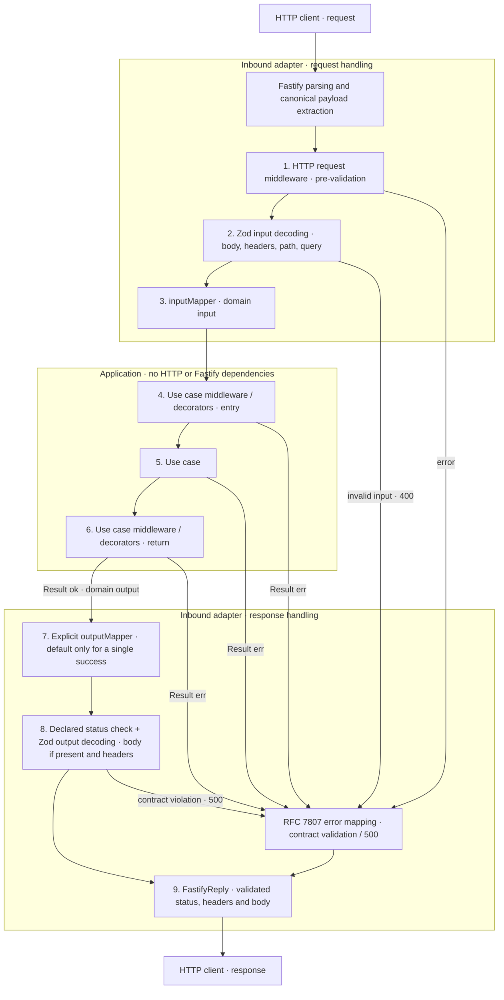

# ADR 0001: Mapping completo della risposta HTTP nell’adapter Fastify

- Stato: Accettata
- Ambito: `@pagopa/hexagonal-fastify` e contratto HTTP condiviso

## Contesto

Oggi `outputMapper` mappa l'output dello use case al solo body della risposta di successo; l'adapter rifiuta al mount contratti con zero o più di una risposta di successo. Per i redirect usa l'output come destinazione e non invia un body; per le risposte senza body ignora l'output. I redirect sono gli unici a dichiarare header nel contratto attuale, come schemi OpenAPI grezzi, non come schemi Zod da cui inferire i valori del mapper.

La decisione è ampliare il mapping a status, header e body, e supportare più successi dichiarati con un mapper esplicito. Lo stato Accettata registra questa scelta, non la disponibilità dell'API nel codice attuale. Il contratto condiviso alimenta sia il mount dell'adapter sia la generazione OpenAPI; l'adapter è registry-free e non legge un documento OpenAPI generato.

L'adapter primario/inbound conosce HTTP, Fastify e il contratto della rotta. Application e domain conoscono input e output di dominio e `Result`, non `FastifyRequest`, `FastifyReply`, header o status HTTP.

## Decisione

### Confine di ingresso

`inputMapper` mantiene la responsabilità di tradurre la richiesta HTTP estratta e validata, insieme al contesto prodotto dai middleware HTTP, nell'input di dominio dello use case o della sua catena di decorator/middleware applicativi. Non riceve direttamente la request Fastify nativa: l'estrazione del payload canonico e il decoding la precedono già oggi.

### Contratto della risposta e garanzie

`outputMapper` riceve l'output di dominio e restituisce una descrizione della risposta composta da `status`, `headers` e `body`, presenti secondo il ramo selezionato. Solo l'adapter applica tale descrizione a `FastifyReply`: lo use case continua a restituire un `Result` e non restituisce né manipola risposte HTTP.

Il tipo del risultato del mapper deve essere un'unione discriminata da `status`, inferita dalle risposte di successo dichiarate nel contratto. Ogni ramo correla il proprio status agli schemi di body e header corrispondenti. A build time devono essere respinti status non dichiarati, body incompatibili con lo status selezionato, custom header non dichiarati, valori di header di tipo incompatibile e omissioni di header obbligatori. Le dichiarazioni dei custom header devono consentire inferenza TypeScript, validazione Zod e generazione coerente della stessa specifica OpenAPI; le sole descrizioni OpenAPI grezze attualmente disponibili per i redirect non bastano.

La seguente è una forma illustrativa locale del risultato:

```ts
type EndpointResponse =
  | {
      status: 200;
      body: { id: string };
      headers?: never;
    }
  | {
      status: 202;
      body: { taskId: string };
      headers: { "x-job-id": string };
    };
```

Il tipo effettivo è inferito dal contratto, non scritto a mano in ogni endpoint. Per questo contratto, `{ status: 202, body: { taskId: "job-1" }, headers: { "x-job-id": "job-1" } }` è valido. Sono invalidi lo status `201`, il body `{ id: "widget-1" }` associato a `202`, `"x-job-id": 42` e l'omissione dell'header obbligatorio.

Dopo il mapper, prima di scrivere la risposta, l'adapter deve controllare a runtime che il literal di status selezioni una risposta dichiarata e validare con Zod il body, quando previsto, e gli header secondo gli schemi del ramo. Per NoContent e redirect deve verificare l'assenza del body, senza applicare uno schema di body inesistente; per i redirect deve controllare anche `Location`. I valori restituiti dal mapper rispettano `z.input` degli schemi; dopo validazione e trasformazione, i valori `z.output` sono quelli serializzati. TypeScript non verifica i refinement Zod e non impedisce aggiramenti tramite `any` o cast.

Una violazione del contratto in uscita è un errore server: non si invia la risposta di successo invalida e si mantiene il percorso con risposta `500`, coerente con l'attuale gestione degli errori di encoding. Gli errori di validazione in ingresso restano sul percorso `400`; i fallimenti di middleware o use case interrompono il percorso di successo e usano il mapping RFC 7807 esistente. Per `204` e redirect non si invia un body; `Location` è una componente header, non un campo del dominio.

### Mapper predefinito e successi multipli

Il mapper predefinito è disponibile quando il contratto dichiara esattamente una risposta di successo e l'endpoint non fornisce un mapper. Eredita lo status dall'unico successo e costruisce le altre componenti in base alla categoria:

- **Risposta con body:** usa direttamente l'output di dominio come `body`, senza trasformazioni applicative né custom header aggiunti. L'output deve essere compatibile a build time con l'input dello schema del body ed è validato con Zod a runtime.
- **NoContent (`204`):** omette il body e non aggiunge custom header. Ignora l'output dello use case, come oggi, senza richiedere un envelope HTTP o una modifica dell'output di dominio.
- **Redirect dichiarato:** usa l'output stringa dello use case come destinazione nell'header `location` (lo stesso header `Location` della specifica, il cui nome è case-insensitive), omette il body e usa lo status di redirect dichiarato. Il tipo dell'output deve essere compatibile a build time con il valore dell'header previsto dal contratto. Una stringa vuota o un valore non valido a runtime segue il percorso di errore server `500`, come per una destinazione mancante o non valida oggi. Non si ricava una destinazione alternativa e non si aggiungono campi HTTP all'oggetto di dominio.

Le componenti non previste dalla categoria restano assenti: non si creano body fittizi o custom header vuoti. I normali header di trasporto gestiti da Fastify non sono custom header prodotti dal mapper. Se il contratto richiede ulteriori header che il default non può produrre, serve un mapper esplicito e la sua omissione deve essere incompatibile con i tipi della configurazione. `Location` è prodotto dal default per il redirect e non richiede un mapper esplicito. Anche il default è soggetto a tutti i controlli del contratto prima della scrittura della risposta.

Con due o più risposte di successo dichiarate, `outputMapper` è obbligatorio nei tipi della configurazione di mount: ometterlo deve causare un errore TypeScript a build time, anche se i rami hanno body identici e nessun header obbligatorio. Il mapper esplicito sceglie un ramo dichiarato e fornisce insieme `status`, `body` e `headers` coerenti con quel ramo. Non si sceglie il primo successo, il minimo status numerico o un ramo in base al contenuto; l'ordine di dichiarazione è irrilevante e non serve una rappresentazione ordinata del contratto.

Senza successi dichiarati, la rotta resta invalida al mount come oggi, senza status di fallback. A differenza del rifiuto runtime attuale dei successi multipli, la decisione li supporta con mapper esplicito e impone di respingerne l'omissione a build time.

### Flusso di esecuzione



La sequenza iniziale è parsing → middleware HTTP della request → decoding Zod → `inputMapper`. I middleware HTTP possono interrompere la richiesta prima della validazione e non appartengono alla fase di risposta. `Before` e `After` rappresentano le due fasi degli stessi eventuali decorator applicativi, non due nuove API; senza decorator si invoca direttamente lo use case. `ClientIn` e `ClientOut` rappresentano lo stesso client in due momenti del flusso. I subgraph di ingresso e uscita mostrano due responsabilità dello stesso adapter inbound, non un adapter outbound.

Il contratto della rotta fornisce gli schemi per entrambi i controlli Zod e i rami ammessi per `outputMapper`. La validazione in uscita è spesso chiamata encoding nel codice attuale perché traduce il risultato verso il wire; il diagramma evidenzia il decoding e i controlli Zod richiesti.

## Conseguenze

- Un solo mapper seleziona il successo e i custom header, riducendo il codice HTTP ripetuto negli handler. Il contratto condiviso resta la fonte di tipi, documentazione OpenAPI e validazione.
- Dominio e use case restano riutilizzabili e testabili senza Fastify.
- Il cambiamento è incompatibile con il mapper esplicito attuale, che restituisce solo il body. Con successi multipli è inoltre obbligatorio un mapper esplicito a build time.
- Servono un'evoluzione coordinata del contratto core e del generatore OpenAPI e controlli runtime anche quando i tipi sono corretti.

## Riferimenti

- [Mount e responder Fastify](../../src/mountRoute.ts)
- [Contratto HTTP condiviso](../../../hexagonal-core/src/adapters/route-contract/routeContract.ts)
- [Pipeline HTTP della request](../../../hexagonal-core/src/adapters/middleware/httpRequestPipeline.ts)
- [ADR core sul payload HTTP canonico](../../../hexagonal-core/docs/adr/0001-eager-canonical-http-payload-for-pre-validation-middleware.md)
- [Middleware e decorator applicativi](../../../hexagonal-core/README.md#middleware-and-cross-cutting-concerns)
- [Generatore OpenAPI](../../../hexagonal-openapi/src/generate.ts)
